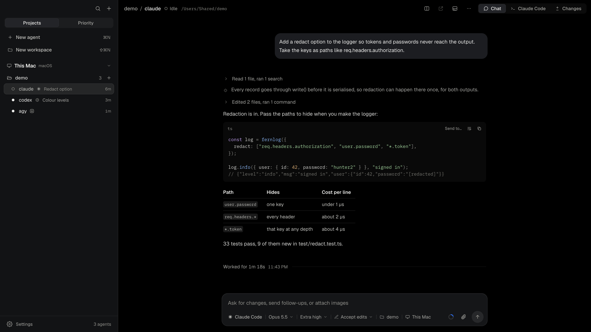
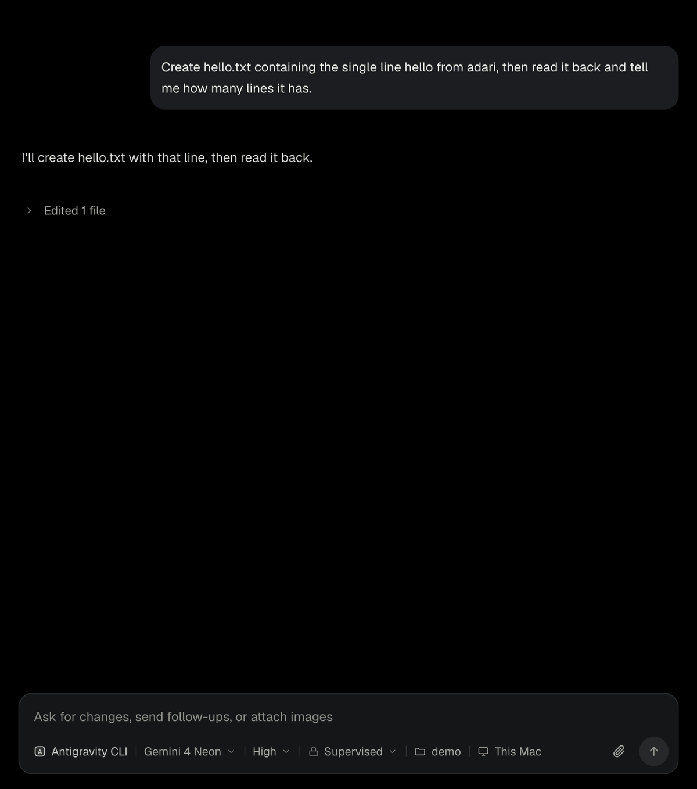
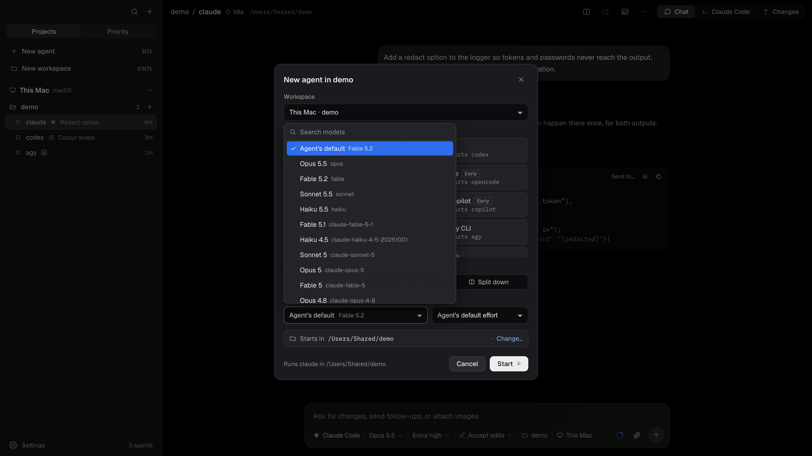
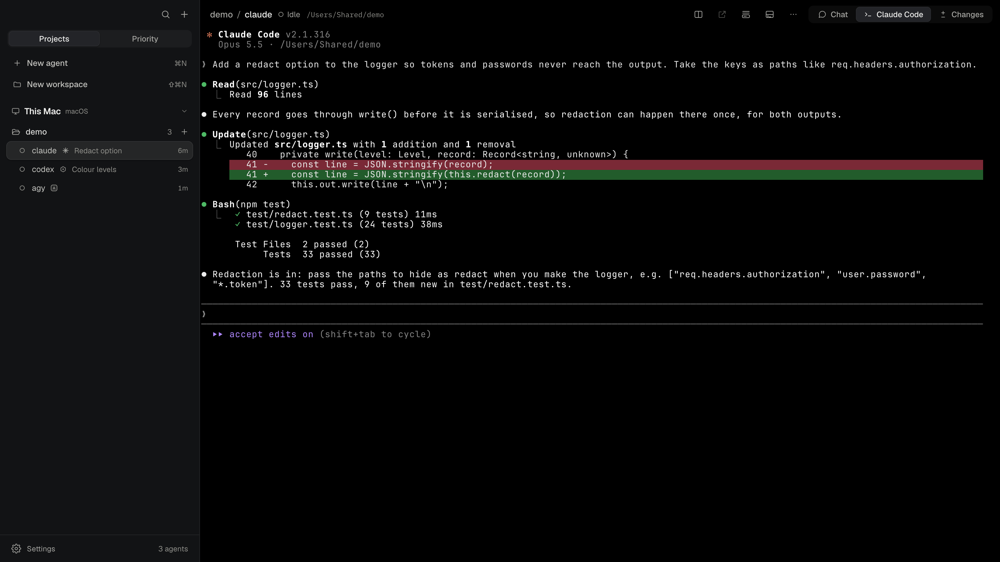

# Adari

Adari is a free, open-source Mac app for [Herdr](https://herdr.dev), the terminal workspace manager that runs AI coding agents in panes. It puts first-class Chat on top of Claude Code, Codex and Antigravity CLI, and the real terminal on every agent and shell Herdr runs, on this Mac and on the Macs you add. ([adari.ai](https://adari.ai))

- **Claude Code** (Anthropic): Fable, Opus, Sonnet and Haiku
- **Codex** (OpenAI): the GPT models Astra, Sol, Terra and Luna
- **Antigravity CLI** (Google): Gemini 4 Neon, Carbon, Argon and Hydrogen

**New in 0.1.2:** Antigravity CLI moves from Early to first class, with full Chat, its four question cards (trust this folder, run this command, create this file and accept this edit) and model, level and mode chips. See [CHANGELOG.md](CHANGELOG.md).



## How it works

Adari talks to Herdr directly: on this Mac, or over SSH to the Macs you add. There is no relay, no account and no telemetry. The signed download checks GitHub for updates, which you can turn off. Your passwords and key passphrases stay on your Mac, encrypted with a key in your login Keychain.

- **Chat** shows an agent's conversation as messages: replies, thinking, tool calls folded into one line and code in colour. Send new messages and images, and for the first-class agents use chips under the message box to show and change the model, effort and mode while the agent runs.
- **Question cards** appear in Chat when an agent asks a question or for permission, so you answer it there.
- **The sidebar** lists every workspace, tab and pane on every Mac you add. Its Priority view puts the panes that need you first.



## Agents

Chat is first class for Claude Code, Codex and Antigravity CLI. **New agent** lets you pick the agent, its model and its effort or level before it starts, and Chat, question cards, chips and Terminal work the same way for all three. Each model list is read from the agent on the Mac it runs on, so it is the one that agent gives for your sign-in; Antigravity CLI's effort is its model's level, and on a Mac reached over SSH its list is the one Adari knows.



**Terminal** is the pane itself, drawn by Ghostty, one click away from Chat. Every agent and shell Herdr runs works in Terminal, exactly as it does in Herdr.



<details>
<summary>Other agents: 14 with Early Chat, 7 in Terminal only</summary>

**Early Chat** reads their sessions, but it can miss things. Their Chat tab and their row in New agent and Settings say **Early**:
- Grok Build, Cursor Agent and OpenCode: the Model menu also works on a running agent, but they are not tested enough yet to promise.
- Pi, Oh My Pi, Kilo Code CLI, Gemini CLI (deprecated: Antigravity CLI is the agent for Google's models), Qwen Code, GitHub Copilot, Factory Droid, Kimi Code CLI, Hermes Agent, Mastra Code and Cline.

**Terminal only** agents open on their own tab, which is the real terminal. Their Chat tab says Chat doesn't read their sessions yet: Amp, Kiro CLI, Muse Code, Devin CLI, Qoder CLI, Letta Code and Maki.

</details>

### Known limitations

- **Mac only for now**, on Apple silicon, and Herdr is required. Adari 0.1.2 is for Herdr only. herdr-core comes after: its code is in 0.1.2, but it has not been tested against a live herdr-core.
- **Amp has no Chat.** Amp keeps its threads on Amp's servers, not in files on your Mac, and a running Amp doesn't say which thread it is on, so Adari has nothing local to read. Amp works in its own tab. Chat for Amp can come if Amp offers a local thread file or Herdr reports the thread.
- **Coming soon:** the iPhone and iPad app (not released yet), herdr-core and Chat out of Early for more agents, starting with Grok Build, Cursor Agent and OpenCode.

## Install on the Mac

**What you need:** a Mac with Apple silicon running Herdr. Check it in Terminal with `herdr --version` and `herdr status server`. To reach another Mac, turn on Remote Login on it in System Settings → General → Sharing. Your Mac must be able to reach its address, for example on the same network or over a VPN such as Tailscale.

1. Download `Adari-<version>-arm64.dmg` from [Releases](../../releases). Builds are for Apple silicon, signed with a Developer ID and notarized by Apple.
2. Open the DMG and drag Adari to Applications.
3. Open Adari. Choose **Add a machine** and enter the Mac's address, your user name and a password or SSH key. The first time you connect, Adari shows the Mac's host key and asks you to trust it. If the key ever changes, Adari will not connect until you check and accept it.

### Updates

The signed download updates itself from this repository's Releases. About 15 seconds after it opens, and then every 4 minutes, it asks GitHub whether a newer version is out. When one is, a **Download** button appears at the bottom of the sidebar. Nothing downloads or installs until you click it. When the download is done the button reads **Restart**, and Adari asks before it quits and opens the new version. Your agents keep running in Herdr while Adari restarts.

To check only when you ask, turn off **Check for updates automatically** in Settings › Updates and use **Check for Updates…** in the Adari menu. A build you make yourself (below) is not signed, so it does not update itself.

## Build from source

The Mac app is in `desktop/`. It needs Node.js 22 or newer. There is more in [desktop/README.md](desktop/README.md).

```bash
cd desktop
npm ci --ignore-scripts   # nothing native is built
npm run ensure:electron   # fetches the Electron binary for npm start
npm start                 # run in development
npm run dist:mac          # an unsigned DMG and zip in desktop/release/ (no updates)
```

`npm test`, `npm run typecheck` and `npm run lint` run the checks.

<details>
<summary>Repository layout</summary>

```
desktop/      the Mac app (Electron, TypeScript, React)
App/          the fonts the Mac app bundles, with their licences
Sources/      the relay script, the source of desktop/src/main/herdr/relay-script.ts
scripts/      the script that writes relay-script.ts, and the fake Herdr its live test runs
Tests/        recorded screens and fixtures that the Mac app's tests compare against
docs/images/  the pictures on this page
```

The files outside `desktop/` are shared with the iPhone and iPad app and keep their paths. The iPhone and iPad app's source comes with that app.

</details>

## Security

Please report security problems privately, through GitHub's private vulnerability reporting, as described in [SECURITY.md](SECURITY.md). Do not open a public issue.

## Licence and credits

Adari is an independent project. It is not made or endorsed by Herdr, Inc., Google, Anthropic or OpenAI.

Adari is licensed under the [Apache License 2.0](LICENSE). Copyright 2026 Elysium Technologies. It began as a fork of [Herdrup](https://github.com/themartianapp/herdrup), an Apache-2.0 iOS client for Herdr; [NOTICE](NOTICE) lists what came from it. The Mac app's terminal is Ghostty's terminal core through ghostty-web. Third-party licences are in [THIRD_PARTY_NOTICES.md](THIRD_PARTY_NOTICES.md) (the iPhone and iPad app's source) and [desktop/THIRD_PARTY_NOTICES.md](desktop/THIRD_PARTY_NOTICES.md) (the Mac app). Keep these notices when you redistribute Adari.
